  

A quirky programmer who builds small tools on a whim. Python / TypeScript / Dart. Learning by making.

## Things I make

- **Test automation.** Python scripts that power-cycle devices and check what their logs say. On my own projects: unit
  tests, Firestore security-rules tests, and pixel-exact screenshot checks with Playwright.
- **Mobile apps.** Flutter + Firebase: sign-in, Firestore, Cloud Functions, push notifications and maps. My Final Year
  Project, [i-Share](https://github.com/teosam89/i-Share), is one.
- **Backends.** REST APIs in Spring Boot with JWT and MySQL behind them, as in
  [Cleaning System](https://github.com/teosam89/Cleaning-System). Serverless ones on Cloudflare Workers + D1.
- **Websites.** My own site, [zerofield.dev](https://zerofield.dev): a little world laid out like a set of drawings,
  with a 3D room inside (three.js, its geometry scripted in Blender with Python). Vue.js for web apps.
- **AI agent workflows.** Claude Code with hooks that enforce my rules, skills, and a review agent that reads every
  change I make.
- **Music videos.** Short animated films, cut to the beat in code (Remotion, three.js, ffmpeg).

## Tools

Python · TypeScript · JavaScript · Dart · Java · SQL · Flutter · Firebase · Spring Boot · Vue.js · three.js ·
Cloudflare · Docker · Git · Linux

**[zerofield.dev](https://zerofield.dev)**

Every image here is hosted in this repo. No third-party requests.
